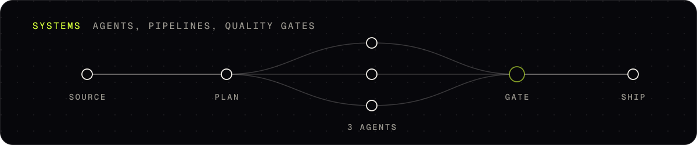

**Motion designer and AI engineer, Mumbai.**

I design interfaces for products that don't exist yet. Then I build them: the screens, the motion that makes them feel alive, and the AI systems running behind them.

## Work

[Tripp'in AI](https://github.com/KevinPratap/Tripp-in): a planner that hands you a real itinerary instead of a chat answer, dressed as a flight briefing.

[AI Tools Directory](https://kevinpratap.github.io/ai-tools-directory/): twelve hundred AI tools you can actually scan.

[Cast](https://kevinpratap.github.io/cast/?demo&auto): superpowers from real hand signs, in your browser. MediaPipe tracks your hands on your own device, and every sign drives real particle physics.

## Systems

- [Agentic workflows](https://github.com/KevinPratap/agentic-workflows): hierarchical agents with quality gates.
- [Shorts Factory](https://github.com/KevinPratap/shorts-factory): source video in, generated clips out.
- [Hermes web dashboard](https://github.com/KevinPratap/hermes-web-dashboard): sessions, cron jobs and skills for agents.
- [24 Week Transformation](https://github.com/KevinPratap/24-week-transformation): fitness tracker with cron-pushed daily content.
- [AI Agents for Beginners](https://www.amazon.com/-/e/B0H6L5ZK6V): a 200 page book, written and produced solo.

## The reel

This is my portfolio, captured: one canvas, one cloud of about 110,000 particles, driven by scroll. [Open the real thing](https://kevinpratap.github.io) and turn the sound on. Every note is synthesized live in the browser.

[Email](mailto:pratapkevin8@gmail.com) · [LinkedIn](https://in.linkedin.com/in/kevin-sidhu-71b127185) · [Plain version of the portfolio](https://kevinpratap.github.io/print/)
